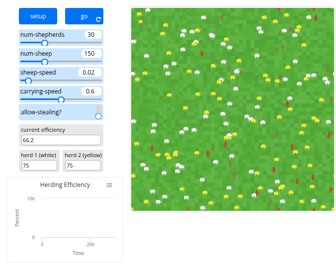
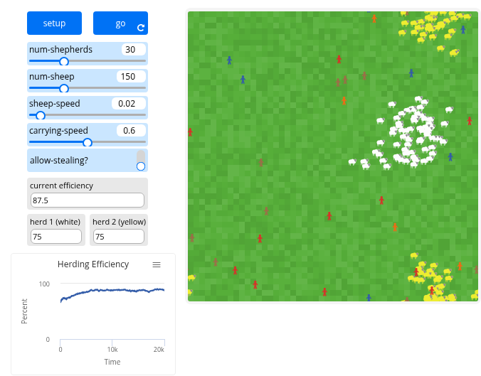
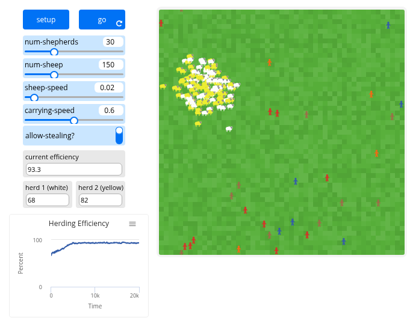
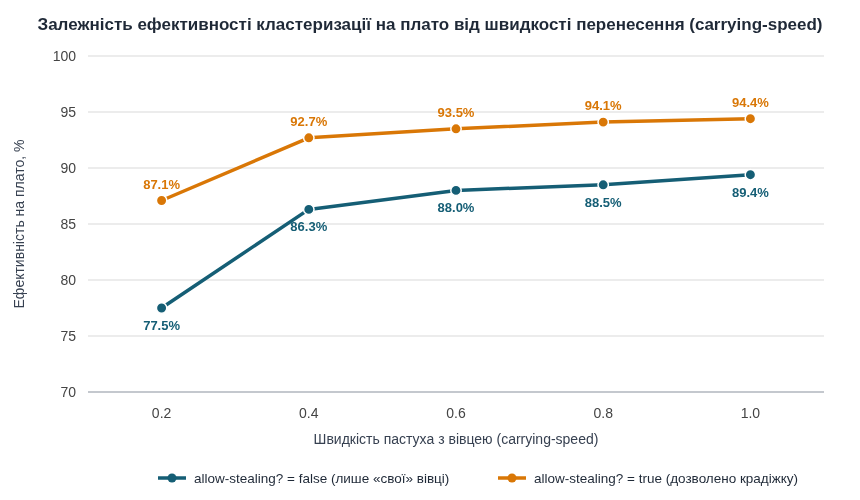
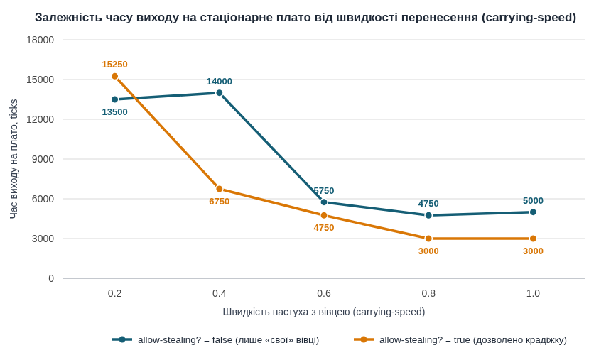

## Комп'ютерні системи імітаційного моделювання
## СПм-25-1, **Шиленко Михайло Павлович**
### Лабораторна робота №**2**. Редагування імітаційних моделей у середовищі NetLogo

<br>

### Варіант 9, модель у середовищі NetLogo:
[Shepherds](http://www.netlogoweb.org/launch#http://www.netlogoweb.org/assets/modelslib/Sample%20Models/Biology/Shepherds.nlogo)

<br>

### Внесені зміни у вихідну логіку моделі, за варіантом:

**1. Поділ овець на два стада та пастухів на дві організації.**  
Замість дублювання порід (`breed`) введено спільну змінну агентів `org` (`1` або `2`), що зберігає приналежність кожної вівці до свого стада, а кожного пастуха — до своєї організації:
```netlogo
turtles-own
[
  org                           ;; приналежність до організації / стада (1 або 2)
]
```

У процедурі `setup` вівці та пастухи рівномірно (50/50 за парністю ідентифікатора `who`) поділяються між двома організаціями з візуальним розрізненням за кольором:
- **Організація 1:** білі вівці (`white`), коричневі пастухи (`brown`; несуть вівцю — `blue`).
- **Організація 2:** жовті вівці (`yellow`), червоні пастухи (`red`; несуть вівцю — `orange`).

```netlogo
  create-sheep num-sheep
    [ ifelse who mod 2 = 0
        [ set org 1
          set color white ]
        [ set org 2
          set color yellow ]
      set size 1.5
      setxy random-xcor random-ycor ]
  create-shepherds num-shepherds
    [ ifelse who mod 2 = 0
        [ set org 1
          set color brown ]
        [ set org 2
          set color red ]
      set size 1.5
      set carried-sheep nobody
      set found-herd? false
      setxy random-xcor random-ycor ]
```

Для спостереження за розмірами обох стад на інтерфейс додано два монітори: `herd 1 (white)` (`count sheep with [org = 1]`) та `herd 2 (yellow)` (`count sheep with [org = 2]`).

**2. Збирання «своїх» овець та відключаєма можливість збирати «чужих» овець зі зміною приналежності.**  
На інтерфейс додано перемикач (Switch) `allow-stealing?`.

У процедурі `search-for-sheep` замість безумовного підбирання будь-якої вівці:
```netlogo
;; Було:
set carried-sheep one-of sheep-here with [not hidden?]
```
реалізовано перевірку режиму `allow-stealing?`: якщо перемикач вимкнено (`false`), пастух бере лише вівцю своєї організації (`org = my-org`), а якщо увімкнено (`true`) — будь-яку видиму вівцю на клітинці:
```netlogo
to search-for-sheep ;; shepherds procedure
  let my-org org
  ifelse allow-stealing?
    [ set carried-sheep one-of sheep-here with [not hidden?] ]
    [ set carried-sheep one-of sheep-here with [not hidden? and org = my-org] ]
  if (carried-sheep != nobody)
    [ ask carried-sheep
        [ hide-turtle ]
      set color ifelse-value (org = 1) [ blue ] [ orange ]
      fd carrying-speed ]
end
```

У процедурі `find-new-herd` пастух шукає стадо саме **своєї** організації:
```netlogo
to find-new-herd ;; shepherds procedure
  let my-org org
  if any? sheep-here with [not hidden? and org = my-org]
    [ set found-herd? true ]
end
```

У процедурі `find-empty-spot` під час висадки вівці їй присвоюється організація (`org`) і колір пастуха. Таким чином, «чужа» вівця після потрапляння до нового стада змінює свою приналежність:
```netlogo
to find-empty-spot ;; shepherds procedure
  if all? sheep-here [hidden?]
    [ let my-org org
      ask carried-sheep
        [ set org my-org
          set color ifelse-value (my-org = 1) [ white ] [ yellow ]
          show-turtle ]
      set color ifelse-value (org = 1) [ brown ] [ red ]
      set carried-sheep nobody
      set found-herd? false
      rt random 360
      fd 20 ]
end
```

<br>

### Внесені зміни у вихідну логіку моделі, на власний розсуд:

**Зменшення швидкості переміщення пастуха під час перенесення вівці (`carrying-speed`).**  
У вихідній моделі пастух завжди переміщується на `1` клітинку за такт (`fd 1`), незалежно від того, чи йде він порожній, чи несе вівцю. Для підвищення реалістичності моделі на інтерфейс додано керуючий слайдер `carrying-speed` (діапазон `0.2 – 1.0`, крок `0.1`, базове значення `0.6`).

У процедурі `go` замість:
```netlogo
;; Було:
fd 1
if carried-sheep != nobody
  [ ask carried-sheep [ move-to myself ] ]
```
використовується умовний крок: порожній пастух рухається зі швидкістю `1`, а з вівцею — зі швидкістю `carrying-speed`:
```netlogo
    ifelse carried-sheep != nobody
      [ fd carrying-speed
        ask carried-sheep [ move-to myself ] ]
      [ fd 1 ]
```

Така зміна є фізично адекватною (перенесення вантажу знижує швидкість руху) і не порушує децентралізованої логіки моделі, а при `carrying-speed = 1.0` зводиться до базової швидкості переміщення.



Фінальний код моделі та оновлений інтерфейс доступні у файлі [Shepherds_Lab2.nlogo](Shepherds_Lab2.nlogo).

<br>

## Обчислювальні експерименти

### 1. Вплив швидкості перенесення (`carrying-speed`) та дозволу крадіжки чужих овець (`allow-stealing?`) на ефективність і швидкість кластеризації

Як і в лабораторній роботі №1, основними показниками роботи системи є **ефективність збирання стад на плато** (`herding-efficiency`, %) та **час виходу на стаціонарне плато** (`ticks`). Додатково фіксувався підсумковий розподіл овець між двома стадами (`Стадо 1 / Стадо 2`).

- **Фіксовані параметри:** `num-shepherds = 30` (по 15 на організацію), `num-sheep = 150` (по 75 на стадо при `t = 0`), `sheep-speed = 0.02`, тривалість прогону `T = 20000 ticks`.
- **Змінні параметри:** `carrying-speed ∈ (0.2, 0.4, 0.6, 0.8, 1.0)` у двох режимах: `allow-stealing? = false` та `allow-stealing? = true`.

#### Серія 1. Режим `allow-stealing? = false` (пастухи збирають лише «своїх» овець)

| № прогону | Швидкість із вівцею (`carrying-speed`) | Початкова ефективність (`t = 0`), % | Ефективність на плато, % | Час виходу на плато, `ticks` | Розподіл овець (Стадо 1 / Стадо 2) |
| :---: | :---: | :---: | :---: | :---: | :---: |
| 1 | 0.2 | 66.4 | 77.5 | 13500 | 75 / 75 |
| 2 | 0.4 | 67.1 | 86.3 | 14000 | 75 / 75 |
| 3 | 0.6 | 66.2 | 88.0 | 5750 | 75 / 75 |
| 4 | 0.8 | 67.1 | 88.5 | 4750 | 75 / 75 |
| 5 | 1.0 | 67.3 | 89.4 | 5000 | 75 / 75 |



#### Серія 2. Режим `allow-stealing? = true` (дозволено збирати «чужих» овець зі зміною приналежності)

| № прогону | Швидкість із вівцею (`carrying-speed`) | Початкова ефективність (`t = 0`), % | Ефективність на плато, % | Час виходу на плато, `ticks` | Розподіл овець (Стадо 1 / Стадо 2) |
| :---: | :---: | :---: | :---: | :---: | :---: |
| 1 | 0.2 | 67.3 | 87.1 | 15250 | 63 / 87 |
| 2 | 0.4 | 65.6 | 92.7 | 6750 | 82 / 68 |
| 3 | 0.6 | 66.8 | 93.5 | 4750 | 68 / 82 |
| 4 | 0.8 | 67.5 | 94.1 | 3000 | 77 / 73 |
| 5 | 1.0 | 66.8 | 94.4 | 3000 | 83 / 67 |



#### Порівняльні графіки залежностей





#### Аналіз результатів і висновки

1. **Вплив поділу на дві організації (`allow-stealing? = false`):** за відсутності крадіжки чисельність стад строго зберігається (`75 / 75`), а на полі формуються два окремі чисті стада (біле та жовте). Максимальна ефективність кластеризації навіть при `carrying-speed = 1.0` становить `89.4%` (що нижче за ~93–94% для одного спільного стада з ЛР №1), оскільки два окремі стада мають більший сумарний периметр, а кожен пастух ігнорує половину овець на полі.
2. **Вплив дозволу крадіжки (`allow-stealing? = true`):** перемикання `allow-stealing?` у стан `true` стабільно підвищує ефективність на плато на **+5.0 – +9.6%** для всіх значень швидкості (до `93.5%` при `carrying-speed = 0.6` і `94.4%` при `1.0`) та скорочує час виходу на плато (до `3000 – 4750 ticks` при `carrying-speed ≥ 0.6`). Це пояснюється тим, що вільні пастухи вдвічі швидше підбирають відбитих овець (незалежно від їхнього поточного стада), а обидва стада поступово стягуються в єдине щільне скупчення з динамічним перерозподілом чисельності (наприклад, `68 / 82`, `83 / 67`).
3. **Вплив власної зміни (`carrying-speed`):** зменшення швидкості пастуха з вівцею від `1.0` до `0.2` монотонно знижує підсумкову ефективність (з `89.4%` до `77.5%` при `false` та з `94.4%` до `87.1%` при `true`) і різко збільшує час виходу на плато (у 2.7 – 5.1 раза, до `13500 – 15250 ticks`), оскільки повільніша доставка овець дозволяє їхній власній дифузії (`sheep-speed = 0.02`) сильніше розмивати межі стад.
4. **Оптимальний робочий діапазон:** починаючи з `carrying-speed ≥ 0.6`, криві ефективності та часу виходу на плато виходять у область насичення (`88.0% – 89.4%` для `false` і `93.5% – 94.4%` для `true`), тож базове значення `0.6` забезпечує реалістичне сповільнення з вантажем без деградації стійкості збирання стад.
